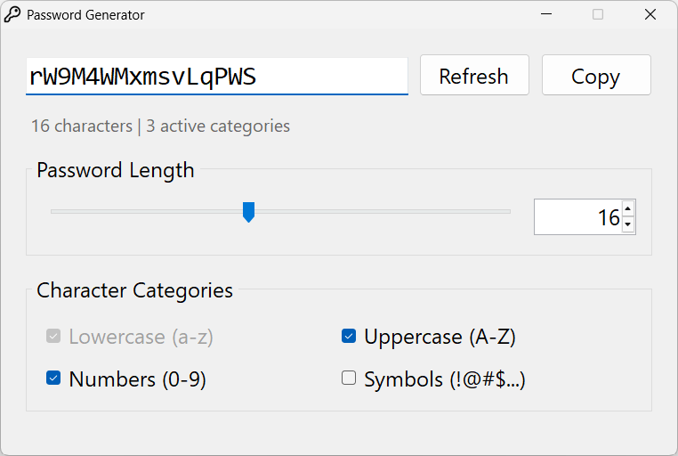

# Password Generator

A lightweight, minimal Windows 11 GUI application for generating cryptographically secure random passwords without external dependencies.



## Features

- **Secure:** Uses `RNGCryptoServiceProvider` with unbiased Fisher-Yates shuffling.
- **Customizable:** Sliders and inputs for length (4–512) and character sets (lowercase, uppercase, numbers, symbols).
- **Fast & Minimal:** Single-file source, zero SDK required, and compiles with the built-in Windows .NET Framework compiler.
- **100% Offline:** Runs entirely locally; no network calls, logging, or storage.

## Download

Download the latest standalone `.exe` (~30 KB) directly from the [**GitHub Releases**](../../releases/latest) page and run it, no installation required.

## Build from Source

Run in PowerShell:

```powershell
& "C:\Windows\Microsoft.NET\Framework64\v4.0.30319\csc.exe" /target:winexe /optimize+ /win32icon:app.ico /out:PasswordGenerator.exe Program.cs
.\PasswordGenerator.exe
```
